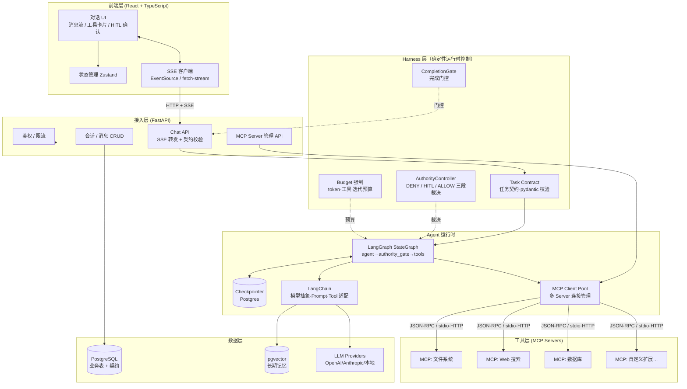

# 02 · 系统架构设计 — AgentFlow

## 1. 总体架构

五层结构：**React 前端 → FastAPI BFF → Harness 层（契约/权限/门控/预算）→ Agent 运行时（LangGraph + LangChain + MCP Client）→ 工具与存储层**。

Harness 层是本项目的产品核心：Agent = Model + Harness，把权限、状态、副作用与完成证明从模型手中转移到确定性运行时。



### 1.1 Harness 层组件职责

| 模块 | 位置 | 职责 |
|---|---|---|
| TaskContract | `app/harness/contract.py` | 契约数据结构（outcome / max_risk / 工具黑白名单 / budgets / gates_enabled），pydantic 校验，API 层非法契约 422 |
| AuthorityController | `app/harness/authority.py` | 对每次 tool_call 做确定性裁决：DENY（黑名单/白名单外/风险超契约）→ 不执行、拒绝消息回喂；REQUIRE_HITL → interrupt 人工确认；ALLOW → 执行。集成于图节点 `authority_gate` |
| CompletionGate | `app/harness/gates.py` | run 自然结束时代码评估：输出非空 / 工具成功率 ≥90% / 预算校验；未通过 → `gate_blocked`。集成于 runtime `_stream_run` |
| Budget 强制 | `runtime._stream_run` + `authority_gate` | token 超限干净终止（`budget_exceeded`，检查点可续）；工具调用/迭代超限在调用前拦截 |

## 2. 组件职责

### 2.1 前端层（React）

| 模块 | 职责 |
|---|---|
| ChatView | 消息列表、输入框、流式渲染（Markdown/代码高亮） |
| ToolCallCard | 展示工具名、参数、结果、耗时、状态 |
| HITLDialog | 渲染 `interrupt` 确认卡片：批准 / 改参 / 拒绝 |
| SessionSidebar | 会话列表管理 |
| AdminPanel | MCP Server 注册与启停、模型配置 |
| StreamClient | 解析 SSE 事件流（token / tool_start / tool_end / interrupt / done） |
| Store（Zustand） | 会话、消息、运行态（thinking/streaming/waiting_approval） |

### 2.2 接入层（FastAPI BFF）

- 统一鉴权（JWT / API Key）与速率限制
- `POST /api/chat` 启动图执行，将 LangGraph 流式事件转译为前端 SSE 协议
- 会话/消息 CRUD 与历史回放
- MCP Server 配置的增删改查与连接健康检查
- **BFF 不含业务智能**：编排逻辑全部收敛在 Agent 运行时

### 2.3 Agent 运行时（核心）

- **LangGraph StateGraph**：定义节点（agent / authority_gate / wait_approval / tools）与边（条件路由），管理 ReAct 循环；契约经 per-run state 注入（`task_contract` 字段），随 checkpoint 持久化
- **Checkpointer（Postgres）**：每个 super-step 保存状态快照（含契约），支撑中断恢复、HITL `interrupt/resume` 与预算超限后续跑
- **LangChain**：模型无关抽象（`init_chat_model`）、Prompt 模板、消息裁剪；把 MCP 工具包装为 `StructuredTool` 供模型绑定
- **MCP Client Pool**：维护与各 MCP Server 的长连接（stdio 子进程 / Streamable HTTP），工具发现、调用路由、故障隔离

### 2.4 工具层（MCP Servers）

独立进程，经标准 MCP 协议暴露 tools/resources/prompts。平台不感知其内部实现，新增能力 = 新增一个 Server 配置。

### 2.5 数据层

- PostgreSQL：用户、会话、消息、MCP 配置、运行轨迹、检查点表
- pgvector：长期记忆向量索引
- LLM Provider：外部 API 或本地推理服务

## 3. 关键设计决策（ADR 摘要）

| # | 决策 | 理由与备选 |
|---|---|---|
| D1 | 后端选 Python/FastAPI | LangGraph/LangChain/MCP SDK 均以 Python 为一线支持；备选 Node 版生态不完整 |
| D2 | LangGraph 而非裸 ReAct 循环 | 需要显式状态图、条件路由、检查点与 interrupt 原语；纯链式（LangChain LCEL）难以表达循环与人机协同 |
| D3 | 工具统一走 MCP 而非 LangChain Tool 直连 | 解耦工具实现与平台；生态即插即用；平台内仍用 LangChain 适配层桥接 |
| D4 | SSE 而非 WebSocket | 单向流式足够；更简单、经代理友好、易重连。预留升级点 |
| D5 | 检查点存 Postgres 而非内存/Redis | 服务重启可恢复是硬需求；与业务库同源降低运维成本 |
| D6 | BFF 与 Runtime 同进程部署（MVP），预留拆分 | MVP 减少运维；LangGraph 节点以接口隔离，后期可独立为 LangGraph Server 水平扩展 |
| D7 | 长期记忆用 pgvector | 与主库一致，避免 MVP 引入独立向量库 |
| D8 | 契约 per-run 经 state 注入，而非 build 时固化 | 图缓存按 model 复用（工具集变更才重建）；契约放图闭包会导致每个契约一份图实例、缓存失效风暴。经 `AgentState.task_contract` 注入随 checkpoint 持久化，中断恢复后契约仍在，且零缓存成本 |
| D9 | DENY 走拒绝 ToolMessage 回喂，而非硬失败 | 拒绝后任务应继续：模型看到拒绝原因可换策略（如改只读方式完成调研）；硬失败会中断整个 run，用户体验与任务完成率都更差。同轮多个拒绝一并回喂，避免悬挂 tool_calls 触发协议错误 |
| D10 | token 预算超限靠 checkpoint 干净终止，而非抛异常 | 检查点每 super-step 已持久化，break 流 + 关闭事件流即可优雅终止（stop_reason=budget_exceeded），可续跑可审计；异常路径会污染 run 状态与 SSE 契约 |

## 4. 前后端流式协议（事件契约）

SSE 事件类型（详见 05-API 设计）：

| 事件 | 载荷 | 说明 |
|---|---|---|
| `run_started` | run_id, task_contract | 图开始执行（含契约摘要回显） |
| `token` | text | LLM 增量输出 |
| `tool_start` | call_id, tool, args | 工具调用开始 |
| `tool_end` | call_id, result, duration_ms, status | 工具结果；**status=denied 表示被 Harness 权限裁决拒绝（未执行）** |
| `interrupt` | interrupt_id, tool, args, risk | 等待人工确认 |
| `state` | node, status | 节点状态（thinking/reflecting…） |
| `fallback` | from, to, error | 模型瞬态故障重试耗尽后降级到备用模型（Phase 2 新增） |
| `run_finished` | usage, stop_reason, model_used, fallback_count, budget, gate_result? | 运行结束；stop_reason 含 gate_blocked / budget_exceeded；budget 为单 run 预算快照 |
| `error` | code, message | 错误 |

> 事件契约为**追加式**：既有事件名与枚举值逐字稳定，仅允许新增事件（本期新增 `fallback`）。

**span 挂点（Phase 2 观测）**：`invoke_workflow`（根）→ 节点 span（`agent` / `authority_gate` / `wait_approval` / `tools`）→ 工具 span / 模型 span。span 由 `graph.astream_events` 事件流驱动构建（零图结构改动，满足 D8），属性遵循 OTel GenAI 语义约定，并挂内存环形缓冲供 `GET /traces/{run_id}` 即时读取，配置 `OTEL_EXPORTER_OTLP_ENDPOINT` 时同时导出 OTLP。

## 5. 部署拓扑

### MVP（单机 Docker Compose）

```
┌─────────────────────────────────────────────┐
│ host                                        │
│  ├─ web        (Nginx 静态托管 React 构建)   │
│  ├─ api        (FastAPI + Agent 运行时)      │
│  ├─ postgres   (业务 + checkpoint + pgvector)│
│  ├─ jaeger     (OTLP 收集 + UI，观测可观测性) │
│  └─ mcp-*      (各 MCP Server 独立容器/进程)  │
└─────────────────────────────────────────────┘
```

### 演进（规模化）

- Agent 运行时独立为 **LangGraph Server**（官方运行时），按 thread 水平扩展；BFF 变纯网关
- MCP Server 集中注册与路由（Streamable HTTP），stdio 型收敛到专用工具节点池
- 引入 Redis 做 SSE 断线重放缓冲；观测 span 汇入 OTel Collector → 后端存储（Jaeger/Tempo）

## 6. 可靠性与降级

| 故障 | 行为 |
|---|---|
| MCP Server 掉线 | Client Pool 标记不可用，工具从当轮可用列表剔除；对话继续 |
| LLM 限流/超时 | 指数退避重试 2 次 → 返回友好错误，会话状态由 checkpoint 保留 |
| 服务重启 | 未完成 run 可从 checkpoint `resume`；SSE 断线由前端带 `Last-Event-ID` 重连 |
| 工具执行异常 | 错误作为 ToolMessage 回喂模型，由图决定重试或改道 |

## 7. 安全边界

- LLM 永远不直接接触宿主：所有副作用经 MCP Server（容器/最小权限进程）
- 高风险工具白名单强制 HITL；数据库 MCP 默认只读账号
- Prompt 注入防护：工具结果包裹分隔标记 + 系统提示约束；MCP Server 元数据视为不可信输入
- API Key 存服务端加密配置，不下发前端
