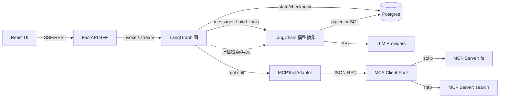

# 03 · 技术选型与分工 — AgentFlow

本文档回答两个问题：**每项技术负责什么（分工）**，以及**为什么选它（选型理由与备选对比）**。

## 1. 技术栈职责总览

| 技术 | 在本项目中的角色 | 负责 | 不负责 |
|---|---|---|---|
| **React** | 前端框架 | 对话 UI、流式渲染、工具卡片、HITL 交互、管理面板 | 任何编排/模型逻辑 |
| **Harness（app/harness/）** | 确定性运行时控制 | Task Contract（契约校验）、AuthorityController（权限裁决）、CompletionGate（完成门控）、Budget（预算强制） | 模型决策、工具实现 |
| **LangChain** | LLM 应用框架 | 模型统一抽象、消息类型、Prompt 模板、工具 Schema 适配、输出解析 | 流程循环控制（交给 LangGraph） |
| **LangGraph** | Agent 编排引擎 | 状态图、ReAct 循环、条件路由、检查点、interrupt/HITL、流式事件 | 工具的具体实现 |
| **MCP** | 工具接入协议 | 工具/资源/提示词的标准发现与调用、Server 进程隔离 | Agent 决策逻辑 |
| FastAPI | Web 框架 / BFF | REST + SSE 接口、鉴权限流、会话 CRUD、配置管理、契约 422 校验 | Agent 智能 |
| PostgreSQL (+pgvector) | 存储 | 业务数据、契约快照、检查点、长期记忆向量 | — |

## 2. 分层选型明细

### 2.1 前端

| 项 | 选择 | 理由 | 备选 |
|---|---|---|---|
| 框架 | React 18 | 生态最成熟；流式 UI（Suspense/并发渲染）友好；团队熟悉 | Vue3、Svelte |
| 语言 | TypeScript | 前后端事件契约（SSE 事件类型）需要类型约束 | — |
| 构建 | Vite | 启动快、配置少 | Next.js（若需 SSR 再评估） |
| 状态 | Zustand | 会话/流式状态轻量全局；样板少 | Redux Toolkit、Jotai |
| 样式 | TailwindCSS + shadcn/ui | 快速构建干净的对话界面 | Ant Design |
| 渲染 | react-markdown + shiki | 消息 Markdown 与代码高亮 | — |
| 流式 | 原生 fetch + ReadableStream 解析 SSE | 需要 POST 携带 body，EventSource 不支持 POST | SSE 库、WebSocket |

**前端关键模块**：`StreamClient`（事件协议解析）、`MessageList`（增量渲染与滚动）、`ToolCallCard`、`ApprovalDialog`（HITL）、`McpAdmin`。

### 2.2 LLM 应用层 — LangChain

**职责边界**：LangChain 在本项目中**只做"模型与消息的抽象层"**，不做流程编排。

- `init_chat_model`：一套代码切换 OpenAI / Anthropic / Ollama 等；会话级模型覆盖由此实现
- 消息类型（`HumanMessage`、`AIMessage`、`ToolMessage`）：与 LangGraph 状态共享同一词汇
- `bind_tools`：将 MCP 工具（经适配层）以 JSON Schema 绑定给模型
- Prompt 模板与上下文裁剪（`trim_messages`）
- 输出解析与多模态消息支持

**理由**：LangChain 与 LangGraph 同族、消息类型互通；MCP 官方 Python SDK 与 LangChain 有成熟桥接模式（`mcpadapt` / 自建适配器）。
**备选**：原生 OpenAI SDK —— 多模型支持需自行抽象，放弃。

### 2.3 编排层 — LangGraph

**职责边界**：所有"控制流"归 LangGraph。

| 能力 | 用途 |
|---|---|
| `StateGraph` + 条件边 | agent/authority_gate/wait_approval/tools 节点的路由与 ReAct 循环 |
| `Annotated` State reducer | messages 追加、工具计数、契约与拒绝记录等状态合并 |
| `Checkpointer`（Postgres） | 每个 super-step 快照（含契约）；断点恢复、时间旅行调试 |
| `interrupt()` / `Command(resume)` | HITL 原生原语，实现 FR-14~16 |
| `astream_events` | 细粒度流式事件 → BFF 转译为前端 SSE |
| Subgraph（预留） | 复杂任务拆分为子图（如研究子代理） |

**理由**：循环 + 人工介入 + 持久化状态是 LangGraph 的三大原生强项，LCEL 链式表达不了。
**备选**：AutoGen/CrewAI —— 多代理协作偏向强，工具协议与检查点不如 LangGraph 可控；自研 while 循环 —— 重复造轮子且无 checkpoint/interrupt。

### 2.4 工具层 — MCP（Model Context Protocol）

**职责边界**：工具的**实现、发现、调用、隔离**全部走 MCP。

- 平台 = MCP Host：内置 `mcp` Python SDK 的 Client 端
- 传输：本地 Server 用 **stdio**（子进程隔离）；远程/共享 Server 用 **Streamable HTTP**
- 能力面：`tools`（主用）、`resources`（预留文件/数据读取）、`prompts`（预留模板库）
- 适配层：`MCPToolAdapter` 把 `list_tools` 结果转为 LangChain `StructuredTool`（名称、描述、inputSchema → args_schema），调用转发给 Client Pool

**理由**：协议标准化 → 工具生态即插即用（官方与社区已有文件系统、数据库、搜索、GitHub 等大量 Server）；进程隔离天然安全边界；与 LLM/框架解耦。
**备选**：LangChain Tool 硬编码 —— 每加一个工具改一次代码、无法隔离，放弃（仅保留极少数内置工具用此方式）。

### 2.5 服务层 — FastAPI

- async 原生，契合 LLM/MCP 的 IO 密集与流式场景
- Pydantic 契约校验；OpenAPI 自动文档
- `StreamingResponse` 实现 SSE
- **备选**：Flask（同步模型不适合流式）、Node/Express（与 Python Agent 运行时割裂）

### 2.6 数据层

| 项 | 选择 | 理由 |
|---|---|---|
| 主库 | PostgreSQL 16 | 业务数据 + LangGraph 官方 Postgres Checkpoint 库 + pgvector 一库三用 |
| 向量 | pgvector | 记忆规模 MVP 内足够；避免独立向量库运维 |
| 缓存/缓冲 | （预留）Redis | SSE 断线重放、限流计数 |
| ORM/迁移 | SQLAlchemy 2.0 (async) + Alembic | 生态标准 |

### 2.7 可观测与运维

| 项 | 选择 |
|---|---|
| LLM 追踪 | OpenTelemetry（双通道：内存环形缓冲 + OTLP→Jaeger）；属性遵循 GenAI 语义约定 |
| 重试/降级 | tenacity（指数退避，仅瞬态异常）+ 配置驱动模型注册表 fallback 链 |
| 日志 | structlog JSON |
| 部署 | Docker Compose（MVP，含 jaeger 一键观测）→ K8s（演进） |
| 包管理 | uv（Python）、pnpm（前端） |

## 3. 协作关系图（谁调用谁）

## 4. 版本基线（设计期约定）

| 依赖 | 基线 |
|---|---|
| Python | 3.11+ |
| Node | 20 LTS |
| react / vite | 18.x / 5.x |
| fastapi / uvicorn | 0.11x / 0.3x |
| langchain-core / langchain | 0.3.x |
| langgraph / langgraph-checkpoint-postgres | 0.2.x / 2.x |
| mcp (Python SDK) | 1.x |
| opentelemetry-sdk / exporter-otlp-proto-http | 1.x |
| tenacity | 9.x |
| postgres / pgvector | 16 / 0.7+ |

> 实现启动时以届时最新稳定版为准，本表仅约束大版本方向。
