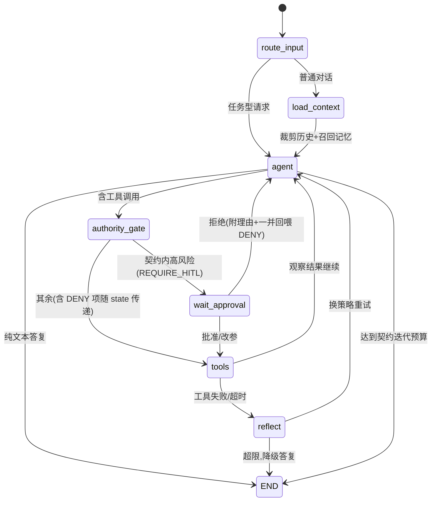
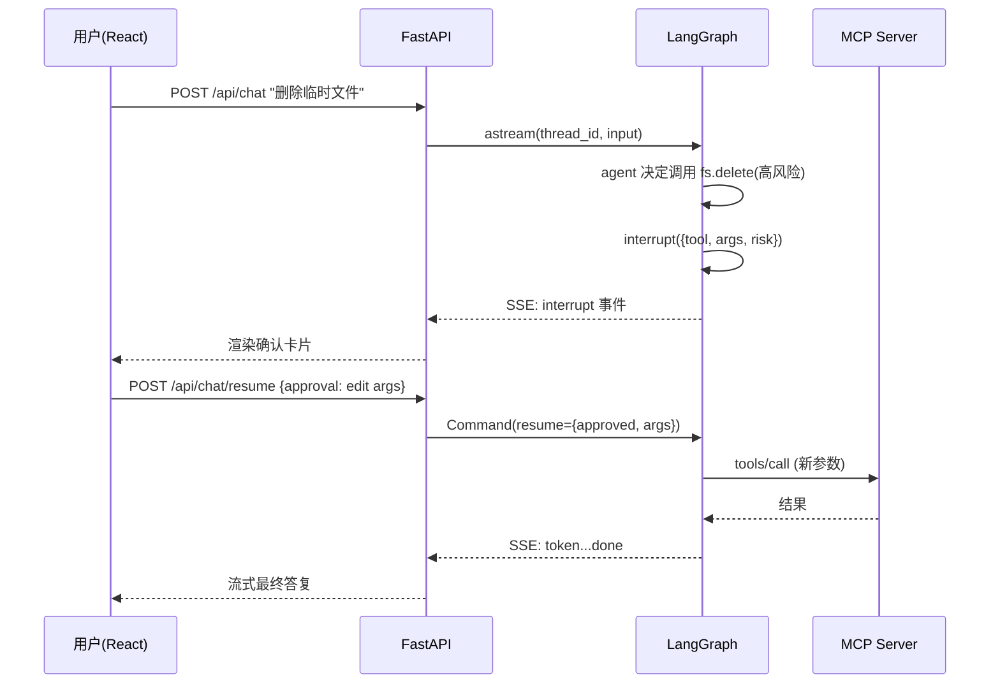

# 04 · Agent 工作流与 MCP 集成设计 — AgentFlow

## 1. LangGraph 状态图设计

### 1.1 状态定义（State Schema）

| 字段 | 类型 | Reducer | 说明 |
|---|---|---|---|
| `messages` | `list[BaseMessage]` | `add_messages` | 对话与工具消息累积 |
| `tool_calls_count` | int | sum | ReAct 循环计数，防失控 |
| `pending_approval` | dict \| None | overwrite | HITL 待确认的工具调用 |
| `approval_result` | dict \| None | overwrite | 用户批准/拒绝/改参结果 |
| `task_contract` | dict \| None | overwrite | **Harness：per-run 任务契约**，随 checkpoint 持久化，中断恢复后仍生效 |
| `denied_calls` | list | overwrite | **Harness：authority_gate 裁决拒绝的调用** [{call_id, tool, reason}]，tools 节点据此生成拒绝回喂 |
| `reflection_notes` | list[str] | append | 反思节点的修正建议 |
| `usage` | dict | merge | 累计 token 用量 |
| `final_answer` | str \| None | overwrite | 结束答案 |

### 1.2 图拓扑



### 1.3 节点职责

| 节点 | 类型 | 职责 |
|---|---|---|
| `route_input` | 路由 | 规则+轻量分类判断：闲聊直答 / 任务走完整流程 |
| `load_context` | 预处理 | Token 预算内裁剪消息（保留最近 N + 摘要）；pgvector 召回长期记忆注入 system |
| `agent` | LLM | 绑定当前可用工具集，产出文本或 `tool_calls`；模型/温度取自会话配置 |
| `authority_gate` | Harness 门控 | **确定性权限裁决**（原 hitl_gate 扩展）：对每个 tool_call 检查契约——黑名单/白名单外/风险超 max_risk/超工具预算 → DENY（记入 denied_calls，不执行）；契约内 high → REQUIRE_HITL（第一个进入 pending_approval）；其余 ALLOW |
| `wait_approval` | 恢复点 | 消费 `Command(resume=...)`：批准→原参/改参执行；拒绝→生成拒绝 ToolMessage（连同同轮 DENY 项）回喂 |
| `tools` | 执行 | 经 MCP Client Pool 执行 tool_calls，产出 ToolMessage；**denied_calls 中的调用不执行，生成拒绝 ToolMessage 回喂模型** |
| `reflect` | 质量 | 工具连续失败时：分析原因、写入 reflection_notes、指导 agent 换策略 |

### 1.4 路由条件

- `agent → END`：无 tool_calls 且文本完整
- `agent → authority_gate`：存在 tool_calls
- `authority_gate → wait_approval`：任一工具裁决为 REQUIRE_HITL
- `authority_gate → tools`：无 HITL 项（DENY 项由 tools 节点以拒绝消息回喂）
- `tools → reflect`：ToolMessage 含 error 且 `tool_calls_count < 契约迭代上限(默认 8)`
- `reflect → END`：达到迭代上限，降级输出"部分完成 + 原因"

### 1.5 循环与终止保护

- 迭代上限：**契约 `budgets.max_iterations` 优先，未配置回退全局 `max_iterations = 8`**；超限强制 END
- 工具调用数：**契约 `budgets.max_tool_calls`，在 authority_gate 调用前拦截**（DENY + 拒绝消息回喂）
- token 预算：**契约 `budgets.max_tokens`，runtime 流式层实时累计，超限干净终止**（stop_reason=budget_exceeded，检查点可续）
- 单工具超时 60s；全 run 超时 10min
- 同一工具+相同参数连续重复 ≥3 次 → 注入提醒消息打破循环（Phase 3）

### 1.6 任务契约生命周期

```
POST /chat {task_contract?}           （缺省 = 默认契约，行为与无契约时一致）
  → FastAPI pydantic 校验（非法 422）
  → Run.task_contract 落库（审计）
  → inputs 注入 AgentState.task_contract（随 checkpoint 持久化）
  → authority_gate / route_after_agent 每步读取契约裁决
  → interrupt 恢复（resume）：从 Run.task_contract 重新加载，契约继续生效
  → run 自然结束：CompletionGate 依据契约评估（gates_enabled）
```

- 契约字段：`outcome` / `max_risk`（low|medium|high）/ `allowed_tools` / `denied_tools` / `budgets{max_tokens, max_tool_calls, max_iterations}` / `gates_enabled` / `invariants`（Phase 3 消费）
- 契约是"可执行信封"：模型在信封内自由探索，运行时强制其不越界

## 2. HITL（interrupt / resume）时序



要点：
- interrupt 状态由 Checkpointer 持久化，**确认请求可跨进程重启存活**（契约状态一并持久化）
- 超时（10min）由后台巡检任务注入"默认拒绝" resume
- 拒绝不终止会话：拒绝理由作为 ToolMessage 回喂 agent，允许改道；同轮被 Harness DENY 的调用一并回喂，避免悬挂 tool_calls

## 3. MCP 集成设计

### 3.1 角色与拓扑

本平台是 **MCP Host**：为每个已启用的 MCP Server 维护一条 Client 连接。

```
Agent 运行时
 ├─ MCPToolAdapter        工具发现/包装（MCP → LangChain StructuredTool）
 └─ MCPClientPool
     ├─ Conn(fs-server)     stdio 子进程
     ├─ Conn(search-server) Streamable HTTP
     └─ Conn(db-server)     stdio 子进程
```

### 3.2 连接生命周期

| 阶段 | 行为 |
|---|---|
| 启动 | 读 `mcp_servers` 表 → 逐个建连 → `initialize` 握手 → `list_tools` 缓存 |
| 运行 | 健康检查（周期 ping）；stdio 进程崩溃自动重启（退避 3 次） |
| 变更 | 管理 API 增删改 → 动态建连/断连 → 工具缓存失效重建 |
| 故障 | 单 Server 不可用仅剔除其工具，不阻塞对话（降级） |

### 3.3 工具命名与冲突

- 注入模型的工具名：`{server_id}__{tool_name}`（如 `filesystem__read_file`）
- 描述前缀标注来源 Server，便于模型区分与前端展示
- 冲突策略：后启用者需管理员显式改名（管理 API 校验）

### 3.4 调用链路

```
agent 产出 tool_call(name, args)
  → tools 节点解析 server_id
  → ClientPool.call_tool(server, name, args, timeout)
  → MCP JSON-RPC tools/call
  → 结果归一化：content[] → 文本/JSON；isError → ToolMessage.error
  → 结构化事件 tool_start/tool_end 推流
```

### 3.5 安全与风险分级

| 级别 | 判定 | 策略 |
|---|---|---|
| low | 只读类（read/search/query-SELECT） | 直接执行 |
| medium | 写文件、写缓存 | 默认直接执行，可按 Agent 配置升级 |
| high | 删除、DB 写、外发请求、支付/消息 | 强制 HITL 白名单 |

- 白名单存 `mcp_servers.risk_overrides` + 全局默认规则（按工具名动词匹配）
- 数据库 Server 使用只读账号；写操作单独 Server 实例 + 强制确认
- MCP Server 返回的文本视为不可信：包裹 `<tool_result>` 标记 + system 提示注入防护

### 3.6 MVP 内置 Server 清单

| Server | 传输 | 工具 | 风险级 |
|---|---|---|---|
| filesystem | stdio（官方） | read_file / write_file / list_dir | read=low, write=medium |
| web-search | stdio | search / fetch_page | low |
| sqlite-query | stdio | query(SELECT) / list_tables | low |
| demo-notify | stdio | send_message | high（演示 HITL） |

### 3.7 预留扩展

- MCP `resources` → 会话附件（上传文件映射为 resource 引用）
- MCP `prompts` → Agent 模板市场
- OAuth 授权型远程 MCP Server（协议已支持，P2）
- 子代理（subgraph agent-as-tool）

## 4. 上下文与记忆策略

- **窗口裁剪**：`trim_messages` 按模型上下文 70% 预算，保留 system + 最近消息；被裁部分滚动摘要
- **长期记忆写入**：`reflect`/会话结束钩子提取稳定事实 → embedding → pgvector（`user_id` 分区）
- **召回**：`load_context` 用最近用户消息向量检索 Top-5，注入 system 段
- **用户主权**：记忆条目列表化可删（FR-19）

## 5. 流式事件映射（LangGraph → SSE）

| LangGraph 事件 | SSE 事件 |
|---|---|
| `on_chat_model_stream` | `token` |
| `on_tool_start` | `tool_start` |
| `on_tool_end` | `tool_end` |
| `interrupt` 出现 | `interrupt` |
| 节点进入/退出 | `state` |
| run 完成 | `run_finished`（含 usage） |
| 异常 | `error` |
