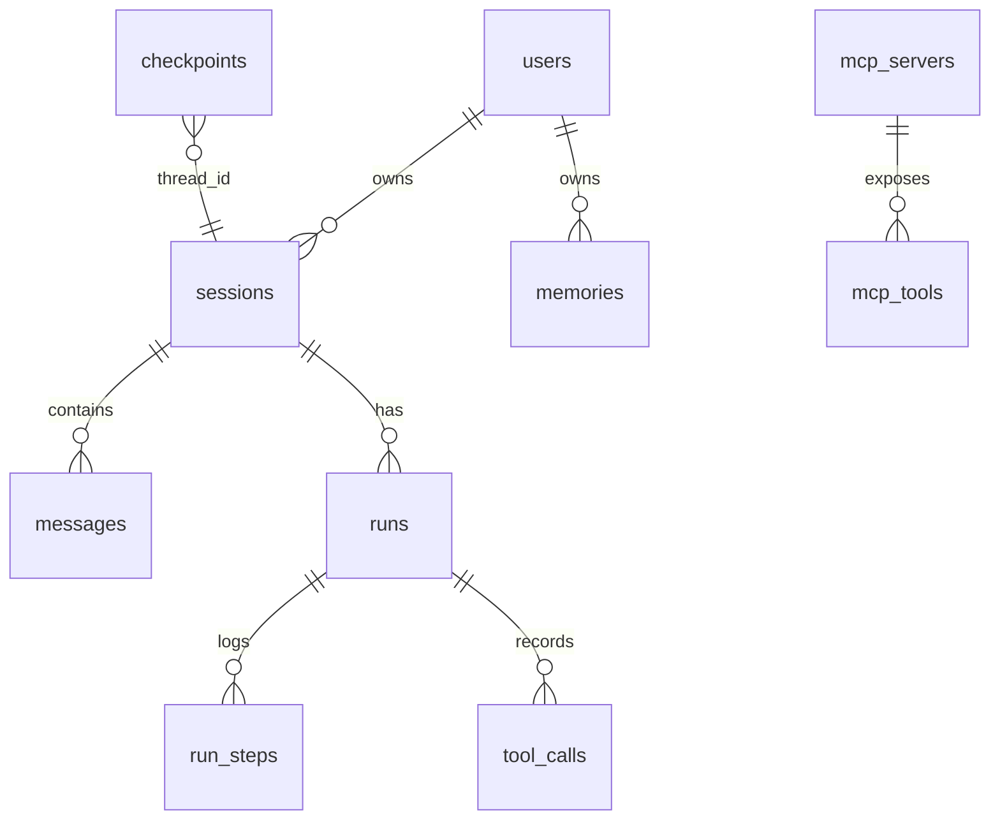

# 06 · 数据模型设计 — AgentFlow

存储：PostgreSQL 16（业务表 + LangGraph 检查点表 + pgvector 记忆表）。

## 1. ER 总览

## 2. 业务表

### users

| 列 | 类型 | 说明 |
|---|---|---|
| id | text PK | `usr_` 前缀 ULID |
| email | text unique | |
| display_name | text | |
| default_model | text | 全局默认模型 |
| created_at | timestamptz | |

### sessions

| 列 | 类型 | 说明 |
|---|---|---|
| id | text PK | `sess_`，同时作为 LangGraph `thread_id` |
| user_id | text FK→users | |
| title | text | 首条消息自动生成，可重命名 |
| model | text nullable | 会话级模型覆盖 |
| system_prompt | text nullable | Agent 人设 |
| status | text | active / archived |
| created_at / updated_at | timestamptz | 索引 (user_id, updated_at desc) |

### messages

| 列 | 类型 | 说明 |
|---|---|---|
| id | text PK | `msg_` |
| session_id | text FK→sessions | 索引 |
| run_id | text FK→runs nullable | 关联产生它的运行 |
| role | text | user / assistant / tool / system |
| content | text | 正文（Markdown） |
| tool_calls | jsonb nullable | `[{call_id, tool, args}]` |
| tool_call_id | text nullable | role=tool 时对应 |
| usage | jsonb nullable | `{input_tokens, output_tokens}` |
| created_at | timestamptz | |

### runs（一次图执行）

| 列 | 类型 | 说明 |
|---|---|---|
| id | text PK | `run_` |
| session_id | text FK | |
| status | text | running / waiting_approval / finished / error / stopped |
| stop_reason | text nullable | end_turn / waiting_approval / **gate_blocked（完成门控未通过）/ budget_exceeded（token 预算耗尽）** / approval_timeout / interrupted_stop / error |
| usage | jsonb | 累计 token |
| task_contract | jsonb nullable | **Harness：本次 run 的任务契约快照**（max_risk / 工具黑白名单 / budgets / gates_enabled），审计与 resume 时重新加载 |
| started_at / finished_at | timestamptz | |

> 已有库升级：`ALTER TABLE runs ADD COLUMN IF NOT EXISTS task_contract JSON`（`app/main.py` 启动时幂等执行；create_all 只建新表不加列）。

### run_steps

| 列 | 类型 | 说明 |
|---|---|---|
| id | bigserial PK | |
| run_id | text FK | 索引 |
| node | text | agent / tools / reflect / hitl_gate… |
| status | text | ok / error |
| duration_ms | int | |
| detail | jsonb | 事件摘要 |

### tool_calls

| 列 | 类型 | 说明 |
|---|---|---|
| id | text PK | `tc_` = MCP call_id |
| run_id / session_id | text FK | |
| server_id | text FK→mcp_servers | |
| tool_name | text | 含 `{server}__{tool}` 前缀 |
| args | jsonb | |
| result | jsonb | 完整结果（大字段 TOAST） |
| status | text | ok / error / **denied（Harness 权限裁决拒绝，未执行）** / rejected / timeout |
| risk_level | text | low / medium / high，**落库时写入 risk 规则+overrides 的真实计算结果**（拒绝记录也含其风险等级） |
| approved_by | text nullable | HITL 批准人 |
| duration_ms | int | |

### mcp_servers

| 列 | 类型 | 说明 |
|---|---|---|
| id | text PK | `mcp_` |
| name | text unique | 用作工具名前缀 |
| transport | text | stdio / streamable_http |
| command / args | text / jsonb | stdio 配置 |
| url | text nullable | http 配置 |
| env_encrypted | bytea | 凭证加密存储 |
| enabled | bool | |
| status | text | connected / degraded / disconnected |
| risk_overrides | jsonb | `{tool: level}` |
| last_checked_at | timestamptz | |

### mcp_tools（发现缓存）

| 列 | 类型 | 说明 |
|---|---|---|
| server_id + name | PK | |
| description | text | |
| input_schema | jsonb | MCP JSON Schema |
| risk_level | text | 规则+覆盖计算结果 |
| discovered_at | timestamptz | |

### memories（长期记忆，pgvector）

| 列 | 类型 | 说明 |
|---|---|---|
| id | text PK | `mem_` |
| user_id | text FK | 分区/过滤键 |
| kind | text | fact / preference / summary |
| content | text | 原文 |
| embedding | vector(1536) | HNSW 索引 |
| source_session_id | text nullable | 溯源 |
| created_at / last_used_at | timestamptz | 衰减用 |

## 3. LangGraph 检查点表

由 `langgraph-checkpoint-postgres` 自建管理（`checkpoints`、`checkpoint_writes`、`checkpoint_blobs`），键为 `thread_id = sessions.id`。**业务代码不直接读写**，仅约定：

- 删除会话时级联调用 checkpointer 的 `adelete_thread`
- checkpoint 保留策略：每会话最近 N=50 个快照，后台任务清理

## 4. 索引与约束要点

- `messages(session_id, created_at)`：历史回放
- `runs(session_id, started_at desc)`：轨迹页
- `memories` HNSW（`embedding vector_cosine_ops`）+ `user_id` 过滤索引
- `tool_calls(run_id)`、`mcp_tools(server_id)`
- 外键均 `ON DELETE CASCADE`（users→sessions→messages 链）

## 5. 数据生命周期

| 数据 | 策略 |
|---|---|
| 消息 | 用户删除会话即物理删除（含导出接口预留） |
| 检查点 | 会话删除/超保留数即清理 |
| 记忆 | 用户可逐条删除；90 天未用进入衰减候选 |
| 运行轨迹 | 保留 30 天（观测用途） |
